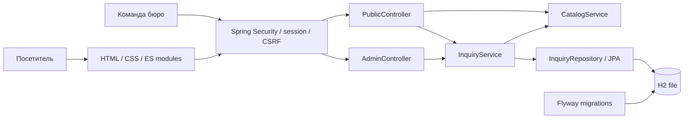
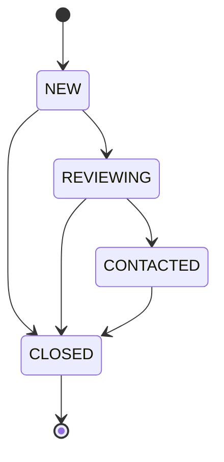

# Архитектура FORMA

## Граница приложения

Один Spring Boot JAR обслуживает статические страницы и REST API. Это позволяет запускать проект одной командой, использовать общую сессию и обойтись без CORS, frontend-сборщика и отдельного Node-сервера.

Пакеты разделены по предметным областям: `catalog`, `inquiry`; HTTP-контракты находятся в `web`, инфраструктура безопасности — в `config`. Сущность не сериализуется напрямую: публичная квитанция не содержит имени/email, кабинет получает отдельный DTO.

## Модель данных

`inquiries` хранит UUID, имя, email, направление, площадь, сообщение, диапазон стоимости, версию тарифов, время согласия, даты создания/обновления, статус и версию строки. Поля ограничены и в DTO, и в схеме. Индексы соответствуют запросам списка: дата, статус + дата.

Снимок расчёта сохраняется при создании заявки. Изменение будущих тарифов не переписывает историю. Стоимость — `long` в целых рублях; текущие тарифы не требуют дробной валюты, поэтому `double` не используется. Сервер не принимает стоимость от браузера.

Миграция `V1` создаёт схему, `ddl-auto: validate` проверяет соответствие JPA. Для изменений базы добавляются новые миграции, уже применённая `V1` не редактируется. Файловая H2 выбрана для воспроизводимого демо без внешних сервисов. PostgreSQL намеренно не заявлен поддерживаемым: его интеграция потребует драйвера, проверки миграций и отдельных тестов.

В файловом URL задан `WRITE_DELAY=0`: задержка сброса журнала после commit отключена. Это исправление появилось после теста немедленного завершения процесса с последующим перезапуском. У H2 по умолчанию задержка составляет 500 мс — см. [SET WRITE_DELAY](https://h2database.com/html/commands.html#set_write_delay). Проверка перезапуска не является испытанием физического отказа диска или питания.

## Повторная отправка и конкуренция

Frontend создаёт `requestId` и держит его в памяти на время одинаковой повторной отправки. Сервер проверяет совпадение всех нормализованных полей. Идентичный повтор возвращает ту же квитанцию, изменённый запрос с тем же ID — `409`. UUID является первичным ключом, поэтому уникальность обеспечивает база, включая одновременную отправку.

`create()` не обёрнут в общую транзакцию намеренно: транзакцией записи управляет `repository.saveAndFlush()`. При гонке уникальности неудачная транзакция откатывается до повторного чтения победившей записи. Nullable `@Version Long` позволяет Spring Data определить новую сущность с заранее заданным UUID и использовать INSERT. Поведение проверено конкурентным тестом.

После перезагрузки страницы идентификатор утрачивается: это защита от повторов в пределах одной отправки, не глобальное распознавание одинаковых обращений. Контакты не записываются в localStorage.

Обновление статуса выполняется транзакционно и требует ожидаемую `version`. Устаревшая версия получает `409`. Даже если две транзакции одновременно прочитали одну версию, `@Version` защищает UPDATE в базе.

Возврат назад и обновление тем же статусом запрещены. Кабинет отображает только разрешённые действия. После конфликта пользователь обновляет список и принимает решение на актуальных данных.

## Безопасность

- Spring Security хранит авторизацию в HTTP-сессии; cookie HttpOnly + SameSite Strict, таймаут неактивности 30 минут. Secure cookie включается переменной при HTTPS.
- Учётная запись создаётся из окружения только при заданном пароле; дефолтного секрета нет. Пароль в памяти представлен BCrypt-хешем. Открытой регистрации и публичного списка заявок нет.
- JSON POST/PATCH и вход/выход защищены CSRF. Браузер получает токен через `/api/csrf`, формы входа/выхода передают `_csrf`. CORS не включён.
- Bean Validation проверяет входные поля; неизвестные JSON-поля отклоняются. Для API ограничены тела до 16 КиБ; вложенные объекты не предусмотрены контрактом.
- Фиксированное окно: 60 API-записей и 10 попыток входа на адрес в минуту. Карта ограничена 10 000 ключей; при заполнении неизвестные адреса получают `429`. Лимиты сбрасываются при рестарте и не общие между экземплярами.
- Прокси-заголовки не влияют на лимит. При запуске за прокси все посетители могут разделять один адрес; внешний limiter на доверенном прокси — следующий шаг для публичного стенда.
- CSP разрешает ресурсы только своего origin; сторонних шрифтов, inline-скриптов и аналитики нет. Пользовательский текст выводится через `textContent`, без `innerHTML`.
- Ошибки имеют формат Problem Details; неожиданные исключения не раскрывают стек, SQL и входные данные. Security-ответы `401/403` могут не содержать JSON, клиент обрабатывает их отдельно.

## Производительность и эксплуатация

Нет N+1-запросов: у заявки нет связанных коллекций. Список ограничен 12 элементами, сортировка по дате и UUID стабильна. `open-in-view` отключён; DTO собираются внутри транзакции чтения. Шрифты локальные с `font-display: swap`; иллюстрации — CSS без тяжёлых изображений и сторонних загрузок.

Для демо Security оставляет стандартный `no-store` у ответов, в том числе статических ресурсов: приоритет — предсказуемая работа с приватными страницами. Версионирование ресурсов и отдельная cache policy — возможная оптимизация при реальной публикации.

Docker содержит отдельный этап сборки и непривилегированного пользователя. Файл базы находится в volume; для консистентной резервной копии приложение останавливается. Автоматическая очистка персональных данных и аудит операций в этот масштаб не входят и явно описаны посетителю.
